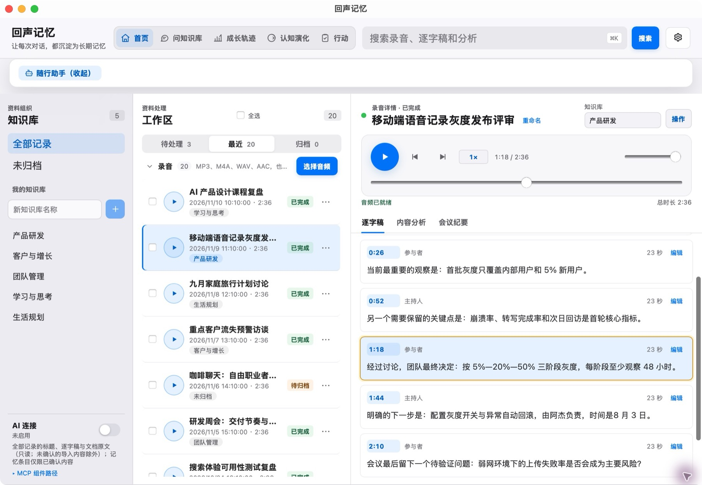
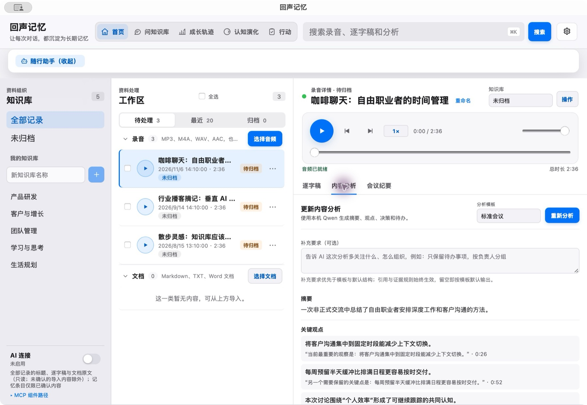
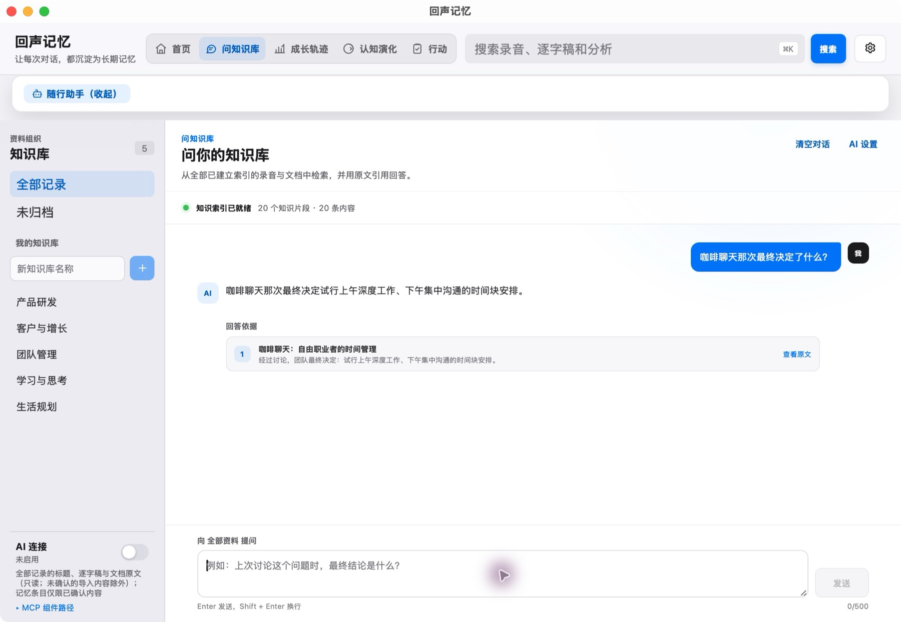
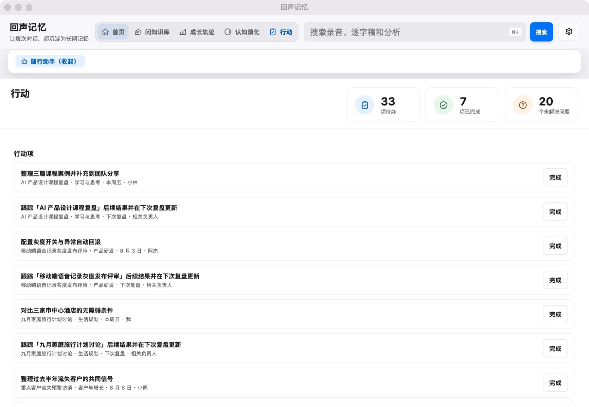
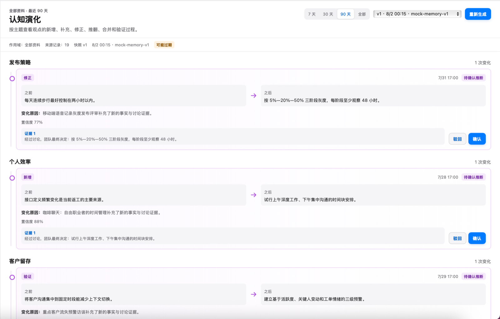
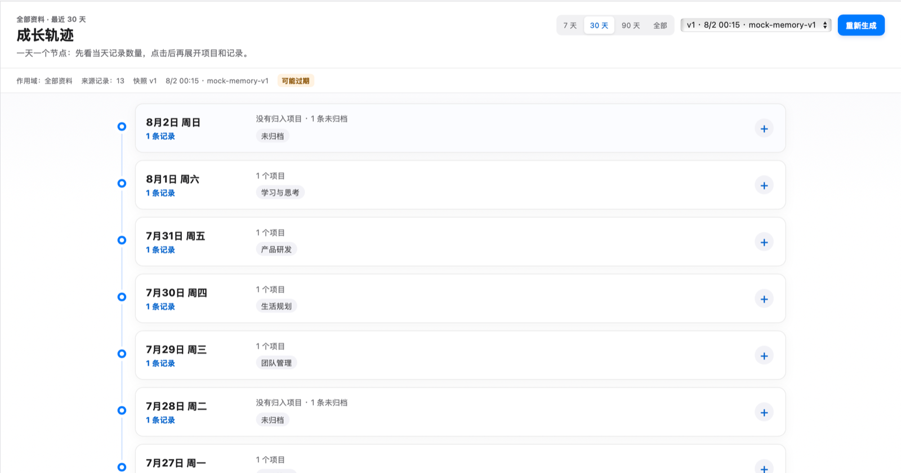
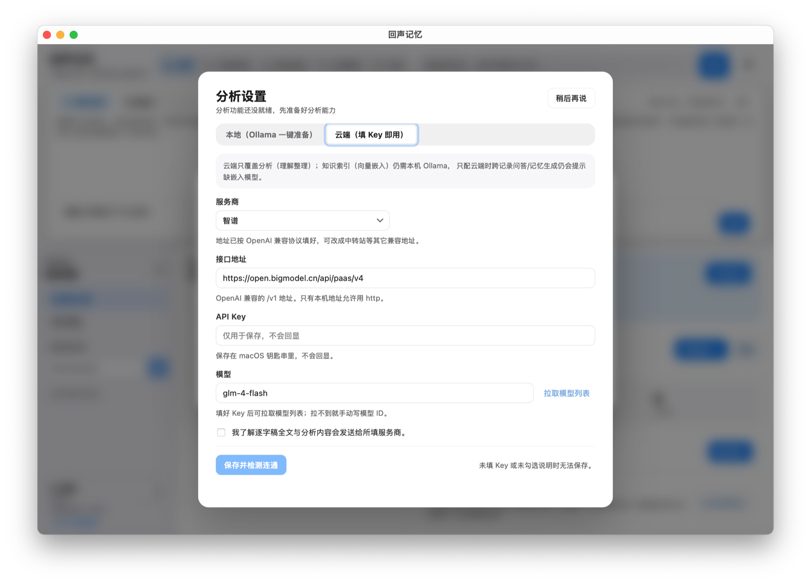

# Echo Memory / 回声记忆

[](https://github.com/questionjie-max/echo-memory/releases/latest)
[](LICENSE)

**No dedicated AI recorder required: turn audio from your phone, voice recorder, camera, or Mac — plus documents and AI chats — into traceable memory your agents can use.**

<p align="center">
  
</p>

[Download latest](https://github.com/questionjie-max/echo-memory/releases/latest) · [MCP reference](docs/mcp.md) · [中文](README.zh-CN.md) · [Contributing](CONTRIBUTING.md)

macOS Apple Silicon · Local-first · Apache-2.0

## The problem

Decisions made in meetings, conclusions from interviews, and ideas worked out in AI chats end up scattered across apps. A week later, you remember the conversation but cannot find the exact words, the evidence behind them, or what happened next.

Most note tools store files or produce one-off summaries. That leaves three gaps:

- **You cannot find it again**: content loses its source, and conclusions cannot return to the original words and timestamp.
- **You cannot trust it**: AI summaries mix inference with fact, with no clear line between them.
- **You cannot carry it forward**: every new AI session starts with you re-explaining your own context.

Dedicated AI recorders also tend to lock capture, transcription, and analysis into one device and cloud, so changing hardware means changing the memory pipeline.

Echo Memory does not lock you to a recorder: audio from phones, voice recorders, cameras, or the Mac can enter one local library alongside documents and AI chats, with permissioned context exposed to your agents through read-only MCP.

## What it does

- **Capture**: record your microphone, a selected app's system audio, or both as one dual-track recording in the app. Import `MP3` / `M4A` / `WAV` / `AAC` audio exported from phones, voice recorders, or cameras, plus `Markdown` / `TXT` / `DOCX` documents, ChatGPT / Claude exports, and local Claude Code / Codex sessions.
- **Understand**: transcribe locally with Whisper and analyze with local Ollama by default, or connect your own third-party transcription and analysis providers independently. Get timestamps, optional speaker separation, chapters, decisions, action items, and open questions.
- **Retrieve with evidence**: search across recordings, documents, and confirmed memories with full-text and vector retrieval. Citations open the originating record or audio, and quotes are compared word for word against the transcript; anything that does not match is not shown.
- **Build long-term memory**: organize project knowledge, explore changes across records in a growth timeline, and generate versioned cognitive-evolution snapshots with evidence plus a first-person personal profile. New conclusions do not overwrite old judgments, and changes can be confirmed or rejected.
- **Let agents use it**: a local, read-only MCP server gives authorized AI tools access to records, project context, action items, confirmed minutes, and confirmed memories.
- **Keep control**: third-party processing is off by default, with separate consent for transcription and analysis; credentials stay in the macOS Keychain. Records can be exported, original files are never auto-deleted, and imported content stays outside MCP memory until you confirm it.

## Hardware-agnostic by design

Dedicated AI recorders often bundle capture, storage, and analysis into one device and cloud. Echo Memory is the memory layer on your Mac; input can come from hardware you already use:

- **Record directly**: use the Mac microphone, a connected input device, or a selected app's system audio; the microphone and system audio can be combined into one dual-track recording.
- **Bring files in**: audio exported from phones, voice recorders, or cameras can reach the Mac over USB, iCloud, AirDrop, or a saved file from a messaging app.
- **Automate intake**: watch folders and USB volumes; once a file is stable, import it, transcribe it, and analyze it automatically.
- **Use one pipeline**: no device-side AI, vendor client, or brand lock-in. Every recording follows the same evidence, knowledge-base, growth-timeline, and MCP path.

Intake is file-based today: Echo Memory does not pair with or control recorders, and it does not read device battery or status. That trade-off is what keeps it independent of vendor SDKs and device generations.

## How it works

```text
Capture → Understand → Connect → Evolve → Retrieve → Feedback
```

- **Capture**: record a conversation, or bring in material you already have.
- **Understand**: transcribe, separate speakers, and extract summaries, decisions, action items, and questions.
- **Connect**: place the result in a project knowledge base and link it to related records and time.
- **Evolve**: build cross-record snapshots that preserve how a view changed and which evidence caused it.
- **Retrieve**: expose confirmed context to agents through MCP.
- **Feedback**: confirm, reject, or correct so the next answer fits you better.

## Interface

Screenshots use synthetic demo data.

### Recording and analysis



Transcript, summary, key points, decisions, action items, and open questions appear on one page; every citation can jump back to the exact words and timestamp.

### Evidence-backed knowledge chat



Answers search both source material and confirmed memories, label the two separately, and let every citation jump back to the original record or audio.

### Action dashboard



Collect action items, completed work, and open questions across records, then jump back to the source or mark an item complete.

### Cognitive evolution



See how views were added, revised, overturned, or merged across records; every change keeps its evidence and can be confirmed or rejected.

### Growth timeline



See changes across projects and records over time instead of flattening memory into disconnected folders.

### Local and third-party model setup



Transcription and analysis can use local or third-party services independently; credentials stay in the macOS Keychain, and sending content externally requires separate consent.

## Quick start

1. Download the latest macOS build from [GitHub Releases](https://github.com/questionjie-max/echo-memory/releases/latest).
2. Open the DMG and drag the app into Applications. First launch guides you through the environment check, local model setup, and inbox configuration.
3. Click "开始记录" on the home screen and choose the microphone or system audio — or import an existing recording, document, or AI conversation.

For a fully local setup, prepare a local Whisper model and Ollama. Third-party transcription and analysis are optional enhancements; the local path works without them. To record system audio, grant access under "System Settings → Privacy & Security → Screen & System Audio Recording"; grant microphone access for microphone recording.

## Local-first and privacy

By default, original audio, the SQLite library, transcription, analysis, retrieval, and MCP all run on your Mac. Recording starts only when you explicitly start it: there is no automatic meeting joining and no background recording.

- Third-party transcription and analysis are two independent opt-ins, each requiring consent to upload audio or send transcript text.
- Provider credentials are stored in the macOS Keychain and are hidden in the interface by default.
- MCP is disabled by default, runs locally over stdio, opens no public port, and cannot modify the library.
- Imported documents and AI conversations enter MCP memory only after you confirm them; withdrawing confirmation hides them again.

## MCP: one memory layer for your agents

The MCP server can search records, read bounded transcript ranges, list projects and action items, return project context, list confirmed minutes by time range, and read your confirmed personal profile (`get_my_context`). Recording source text is readable within the authorized scope; cross-record memory items are returned only after confirmation.

See the [MCP reference](docs/mcp.md) for the tool list and client configuration.

## Current scope

Echo Memory is currently designed for a single user on a single device, and supports macOS Apple Silicon only. It is not a meeting bot or an always-on recorder.

Automatic meeting joining, Windows or mobile apps, cloud sync, team collaboration, a public API, and MCP writes are not provided.

## Long-term direction

The goal is not to build a larger transcription tool or another recording device. It is to make the memory layer independent of specific hardware and grow traceable conversation memory into personal memory infrastructure:

1. **Personal Memory Layer**: permissioned context so every AI does not need to learn you from zero.
2. **Cognitive Database**: evidence-backed knowledge, decisions, questions, and how beliefs change.
3. **Personal Memory OS**: one system for capturing, understanding, organizing, retrieving, and refining memory.
4. **Digital Twin Database**: a long-term, correctable model of what a person experienced, knows, values, and how they make decisions.

This is a long-term direction, not a claim that the current release can fully model a person.

## Requirements

- macOS Apple Silicon
- Node.js 22+, Rust stable, Cargo, and Xcode Command Line Tools
- CMake for the first embedded Whisper build
- Optional: a local Whisper `ggml-*.bin` model, Ollama, and `whisperX` with a HuggingFace token for speaker separation

## Run locally

```bash
cd app
npm install
bash scripts/check-env.sh
npm run tauri dev
```

The default library is stored at `~/Library/Application Support/回声记忆`. Use `ECHO_LIBRARY_ROOT` for an isolated development or test library.

## Verify

```bash
cd app
npm run typecheck
npm run build
npm run test:growth
npm run test:ui
cd src-tauri
cargo fmt --check
cargo test --features mcp-bin
```

## Repository layout

- `app/`: the Tauri application. `app/src/` is the React frontend; `app/src-tauri/src/` is the Rust backend; `app/src-tauri/migrations/` holds database migrations.
- `docs/`: product documentation, design notes, screenshots, and release notes.
- `benchmarks/`: performance benchmarks and sample clips.
- `.github/`: CI workflows and issue templates.

## Versions and updates

The README describes the long-term product, stable capabilities, and current scope. New features, fixes, compatibility changes, and verification results are recorded in [GitHub Releases](https://github.com/questionjie-max/echo-memory/releases); detailed notes live in `docs/release-notes-*.md`.

- [Download the latest release](https://github.com/questionjie-max/echo-memory/releases/latest)
- [Browse all releases](https://github.com/questionjie-max/echo-memory/releases)

## Contributing

Issues and pull requests are welcome. Read [CONTRIBUTING.md](CONTRIBUTING.md) first. Never attach real audio, transcripts, databases, credentials, or private customer material to a public issue. Report security issues privately as described in [SECURITY.md](SECURITY.md).

## License

Apache-2.0. See [LICENSE](LICENSE).
