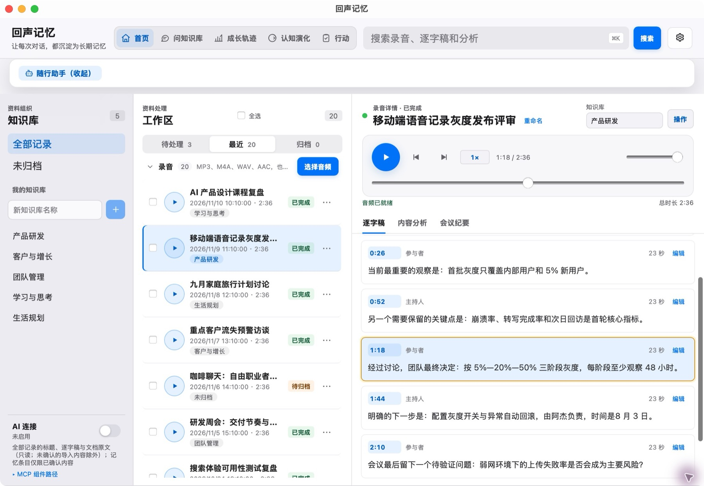
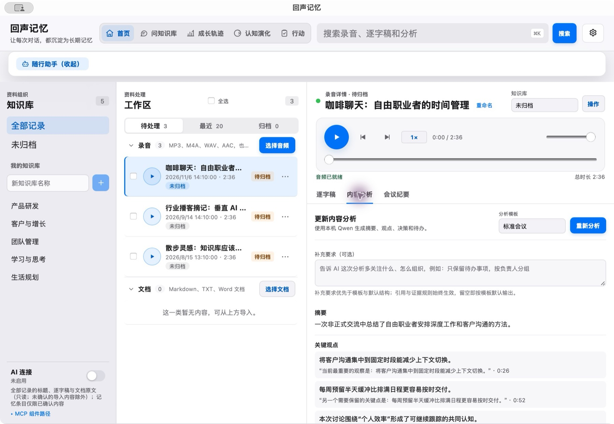
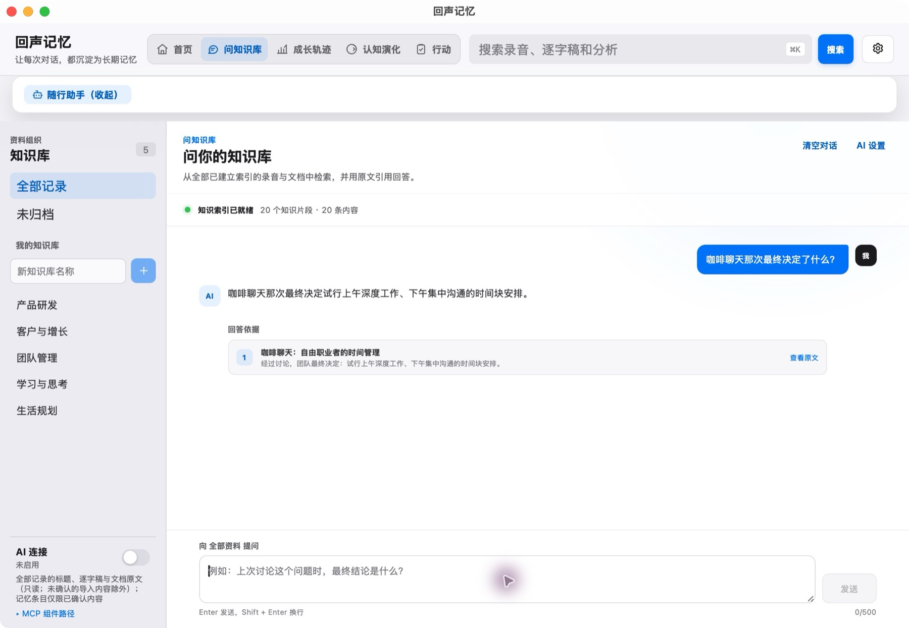
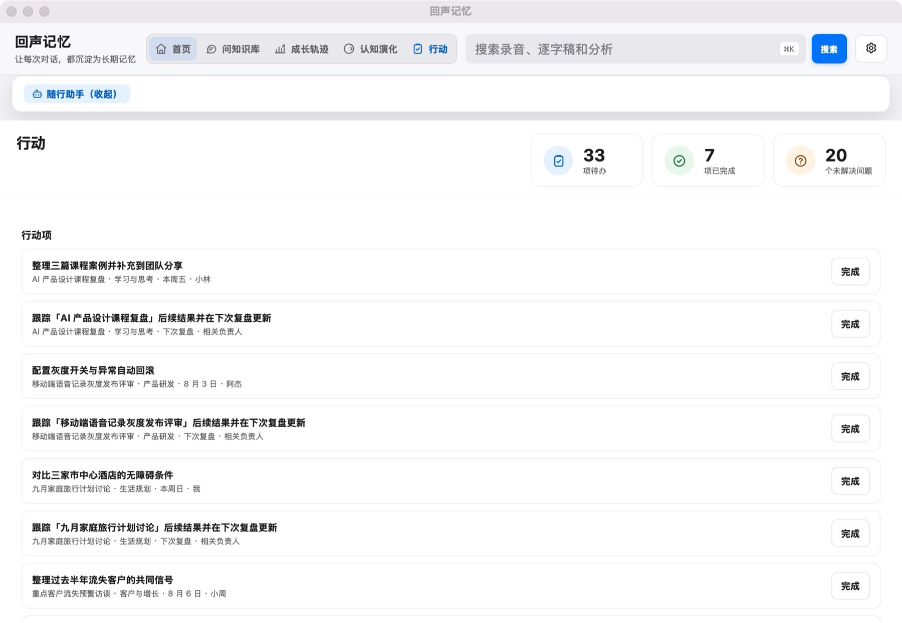
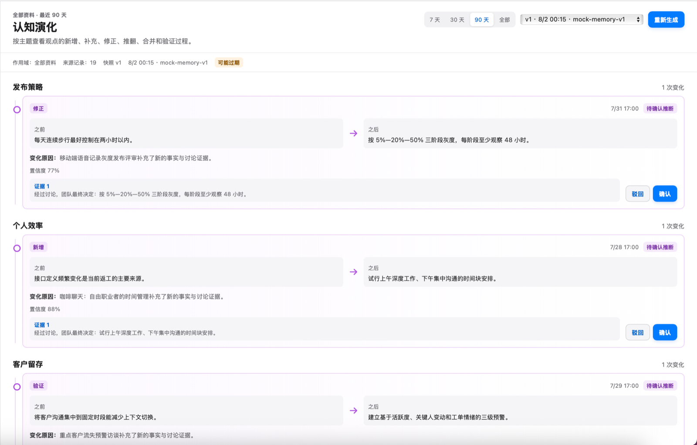
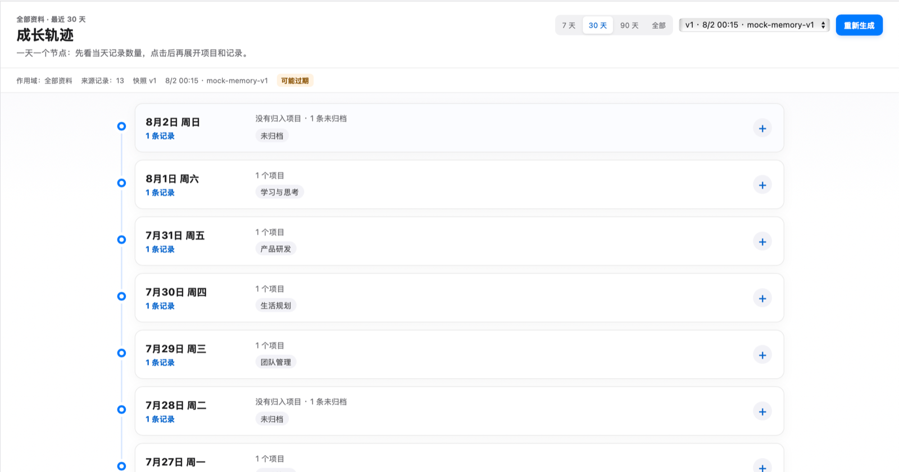
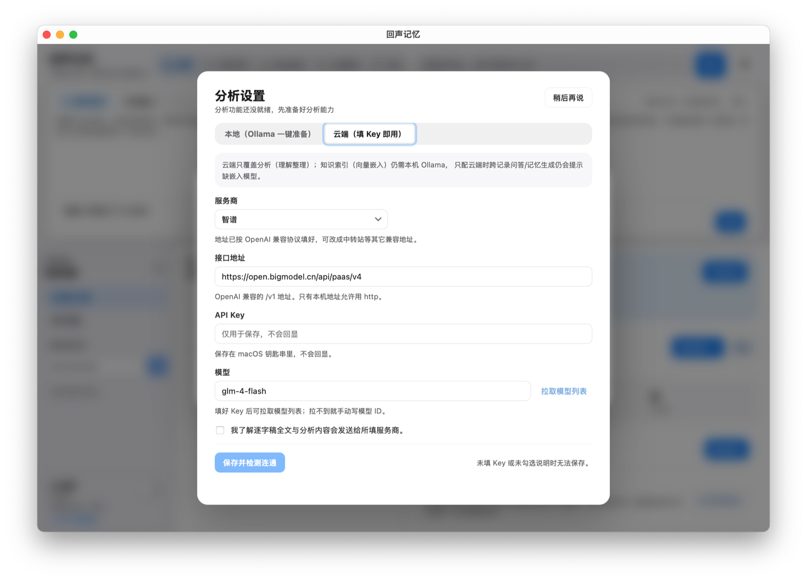

# 回声记忆 / Echo Memory

[](https://github.com/questionjie-max/echo-memory/releases/latest)
[](LICENSE)

**不绑定某一款录音硬件：把手机、录音笔、相机或 Mac 里的录音，连同文档和 AI 对话，沉淀成可追溯、可被 Agent 调用的长期记忆。**

<p align="center">
  
</p>

[下载最新版](https://github.com/questionjie-max/echo-memory/releases/latest) · [MCP 说明](docs/mcp.md) · [English](README.md) · [参与贡献](CONTRIBUTING.md)

macOS Apple Silicon · 本地优先 · Apache-2.0

## 解决的问题

会议里的决定、访谈中的结论、AI 对话里想通的方法，往往散落在不同 App 里。过一段时间，你只记得自己聊过，却找不回原话、当时依据，以及后来做了什么。

普通记录工具保存文件，或者生成一次性的总结，通常留下三个缺口：

- **找不回**：内容和来源脱节，结论无法回到原话和时间点。
- **信不过**：AI 摘要混入推断，却看不出哪些是事实、哪些是猜测。
- **带不走**：每开一个新会话，都要重新向 AI 交代自己的背景。

专用 AI 录音硬件还常把采集、转写和分析锁在同一套设备与云服务里；设备换代，记忆链路也跟着换。

回声记忆不绑定某款录音卡：手机、录音笔、相机，或 Mac 自己录下的音频，都能进入同一个本地记忆库；再连同文档和 AI 对话，通过只读 MCP 把有权限的上下文交给你的 Agent。

## 核心能力

- **采集**：在 App 内一键录制麦克风、所选应用的系统声音或双路录音；也可导入手机、录音笔、相机等设备导出的 `MP3` / `M4A` / `WAV` / `AAC`，以及 `Markdown` / `TXT` / `DOCX`、ChatGPT / Claude 导出和 Claude Code / Codex 本机会话。
- **理解**：默认用本机 Whisper 转写、本机 Ollama 分析；也可分别接入你自己的第三方转写与分析服务。支持逐字时间戳、可选说话人分离、章节、决策、待办和未解决问题。
- **带证据地检索**：在录音、文档和已确认记忆之间做全文与向量检索；答案引用可以回到原记录或原声。金句与逐字稿逐字比对，对不上就不展示。
- **形成长期记忆**：按项目组织知识库，用成长轨迹查看跨记录变化，生成带版本和证据的认知演化快照与第一人称个人总述。新结论不会覆盖旧判断，变化可以确认或驳回。
- **让 Agent 调用**：通过本机只读 MCP，把记录、项目上下文、待办、已确认纪要和已确认记忆提供给授权的 AI 工具。
- **把控制权留给用户**：第三方处理默认关闭，转写与分析分别授权；凭据保存在 macOS 钥匙串。记录可导出，原始文件不会被自动删除，导入内容在确认前不会进入 MCP 记忆范围。

## 不被录音硬件绑定

专用 AI 录音硬件通常把采集、存储和分析绑在同一套设备与云服务里。回声记忆只做 Mac 上的记忆层，输入可以来自你已经在用的设备：

- **直接录**：Mac 麦克风、已连接的输入设备，或所选 App 的系统声音；麦克风与系统声音还能合成一条双路录音。
- **文件接入**：手机、录音笔、相机等设备导出的音频，通过 USB、iCloud、AirDrop 或聊天软件另存到 Mac 即可。
- **自动收件箱**：监听指定文件夹与 USB 卷；文件写稳后自动导入、转写和分析。
- **同一条链路**：不要求设备自带 AI、不要求厂商客户端，也不锁品牌；所有录音进入同一套证据、知识库、成长轨迹与 MCP。

当前采用文件级接入，不配对或控制录音设备，也不读取设备电量与状态。这个取舍换来的是跨品牌、跨设备代际的兼容性。

## 工作方式

```text
采集 → 理解 → 连接 → 演化 → 调用 → 反馈
```

- **采集**：录一段，或把已有材料带进来。
- **理解**：转写、区分说话人，提取摘要、决策、待办和问题。
- **连接**：放进项目知识库，与相关记录和时间建立联系。
- **演化**：跨记录形成记忆快照，保留观点如何改变，以及哪些证据触发了变化。
- **调用**：经过确认的上下文通过 MCP 提供给 Agent。
- **反馈**：确认、驳回或修正，让下一轮回答更贴近你。

## 界面

以下截图使用虚构演示数据。

### 记录与内容分析



逐字稿、摘要、关键观点、决策、待办和未解决问题在同一页展开；引用可以跳回原话和时间点。

### 带证据的知识问答



答案同时检索资料原文与已经确认的记忆条目，两类来源分别标注；引用可以直接跳回原记录或原声。

### 行动



跨记录汇总待办、已完成事项和未解决问题，可以回到来源记录或直接标记完成。

### 认知演化



跨记录查看观点如何新增、修正、推翻或合并；每条变化都保留证据，可以确认或驳回。

### 成长轨迹



按时间查看跨项目、跨记录的变化，而不是把记忆压成一堆互不相干的文件夹。

### 本地与第三方模型设置



分析和转写可以分别选择本机或第三方服务，凭据保存在 macOS 钥匙串，上传内容需要单独授权。

## 快速开始

1. 从 [GitHub Releases](https://github.com/questionjie-max/echo-memory/releases/latest) 下载最新的 macOS 安装包。
2. 打开 DMG，将应用拖入「应用程序」，首次启动会引导环境检查、本地模型准备和收件箱配置。
3. 在首页点「开始记录」，选择麦克风或系统声音；也可以导入已有录音、文档或 AI 对话。

如果希望完全本地运行，请准备本机 Whisper 模型与 Ollama。第三方转写和分析是可选增强，不配置也能使用本地链路。录制系统声音时，需要在「系统设置 → 隐私与安全性 → 录屏与系统录音」中授权；录制麦克风时授予麦克风权限。

## 本地优先与隐私

默认情况下，原始音频、SQLite 资料库、转写、分析、检索和 MCP 都在你的 Mac 上运行。只有你明确开始后才会录制，不会自动入会，也不会在后台偷录。

- 第三方转写与分析是两个独立开关，必须分别同意上传音频或发送转写文本。
- 服务商凭据保存在 macOS 钥匙串中，默认不在界面回显。
- MCP 默认关闭、只在本机通过 stdio 运行，不监听公网端口，也不能修改资料库。
- 导入的文档和 AI 对话需要你确认后才进入 MCP 记忆范围；撤回确认后会再次隐藏。

## MCP：让 Agent 使用同一份记忆

MCP Server 可以搜索记录、读取有限范围的逐字稿、列出项目与待办、获取项目上下文、按时间范围读取已确认纪要，并读取你确认过的个人总述（`get_my_context`）。录音原文在授权范围内可读；跨记录记忆条目只返回你确认过的内容。

工具清单和客户端配置见 [MCP 说明](docs/mcp.md)。

## 当前边界

回声记忆目前面向单用户、单设备的工作流，只支持 macOS Apple Silicon。它不是会议机器人，也不是常开录音器。

当前不提供自动入会、Windows / 手机端、云同步、团队协作、公开 API 或 MCP 写入。

## 长期方向

产品方向不是做更大的转写工具，也不是另一款录音硬件，而是让记忆层独立于具体设备，把可追溯的谈话记忆扩展为个人记忆基础设施：

1. **Personal Memory Layer**：让不同 AI 不必每次从零认识你。
2. **Cognitive Database**：保存带证据的知识、决策、问题，以及观点如何变化。
3. **Personal Memory OS**：统一管理记忆的采集、理解、组织、调用与反馈。
4. **Digital Twin Database**：长期、可纠正地描述一个人经历过什么、知道什么、重视什么，以及如何作出判断。

这是长期方向，不代表当前版本已经能够完整建模一个人。

## 环境要求

- macOS Apple Silicon
- Node.js 22+、Rust stable、Cargo 和 Xcode Command Line Tools
- 首次构建内嵌 Whisper 时需要 CMake
- 可选：本机 Whisper `ggml-*.bin` 模型、Ollama，以及 `whisperX` 与 HuggingFace Token（用于说话人分离）

## 本地运行

```bash
cd app
npm install
bash scripts/check-env.sh
npm run tauri dev
```

默认资料库位于 `~/Library/Application Support/回声记忆`。开发或测试时可以设置 `ECHO_LIBRARY_ROOT` 使用独立资料库。

## 验证

```bash
cd app
npm run typecheck
npm run build
npm run test:growth
npm run test:ui
cd src-tauri
cargo fmt --check
cargo test --features mcp-bin
```

## 仓库结构

- `app/`：Tauri 应用。`app/src/` 是 React 前端；`app/src-tauri/src/` 是 Rust 后端；`app/src-tauri/migrations/` 是数据库迁移。
- `docs/`：产品文档、设计笔记、截图和各版本的发布说明。
- `benchmarks/`：性能基准与示例片段。
- `.github/`：CI 工作流和 Issue 模板。

## 版本与更新

README 只维护长期产品介绍、稳定能力和当前边界。每个版本的功能新增、修复、兼容性变化与验证结果统一记录在 [GitHub Releases](https://github.com/questionjie-max/echo-memory/releases)，详细发布说明保存在 `docs/release-notes-*.md`。

- [下载最新版](https://github.com/questionjie-max/echo-memory/releases/latest)
- [查看全部版本](https://github.com/questionjie-max/echo-memory/releases)

## 参与贡献

欢迎提交 Issue 或 PR。开始前请阅读 [CONTRIBUTING.md](CONTRIBUTING.md)。不要在公开 Issue 中附带真实音频、逐字稿、数据库、密钥或客户资料。安全问题请按 [SECURITY.md](SECURITY.md) 私密报告。

## 许可证

Apache-2.0，见 [LICENSE](LICENSE)。
