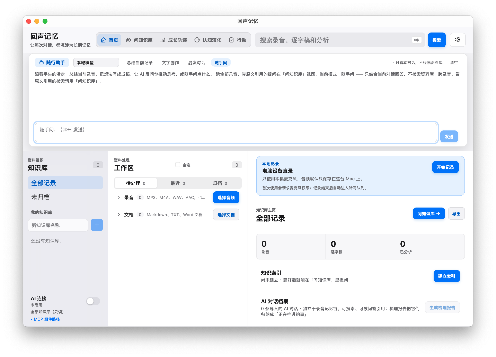
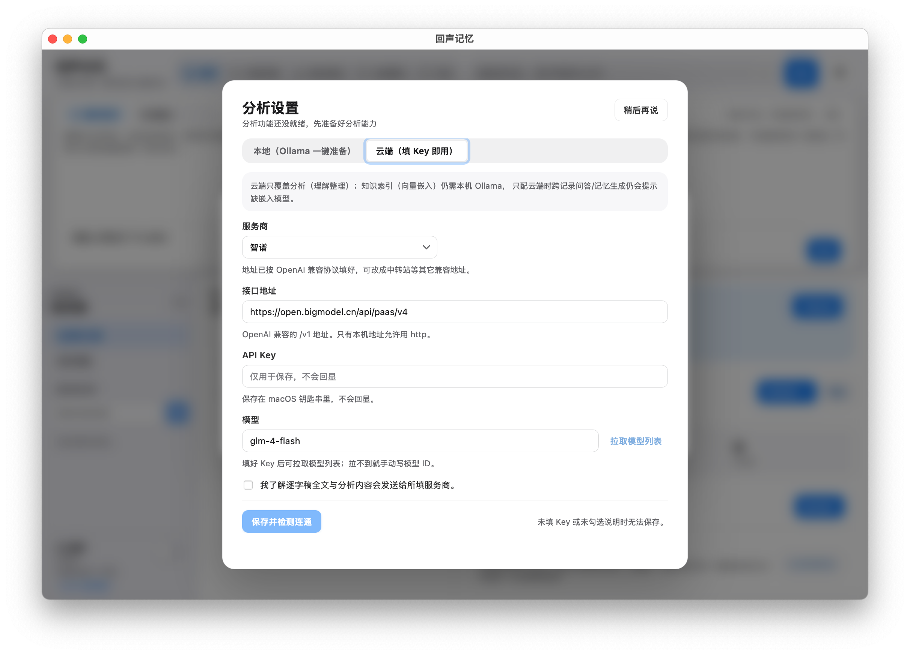
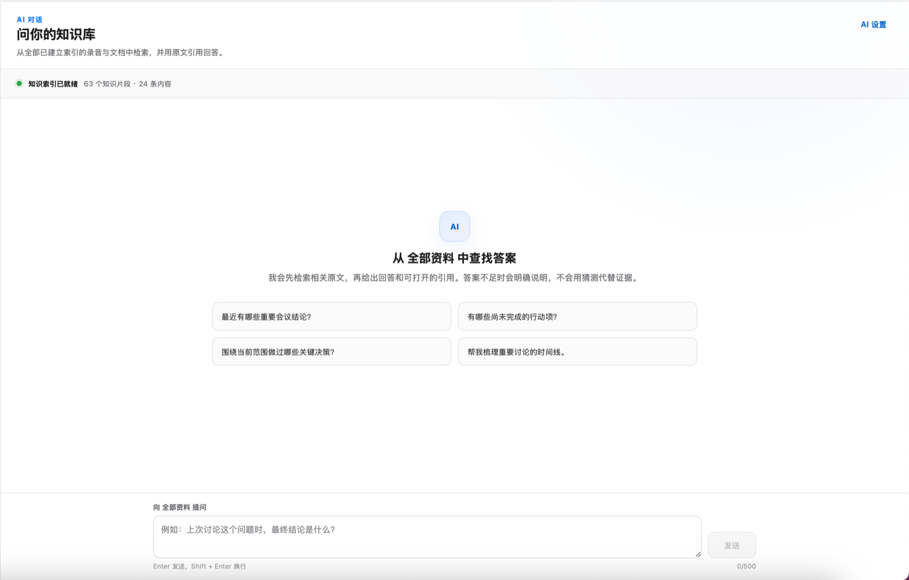
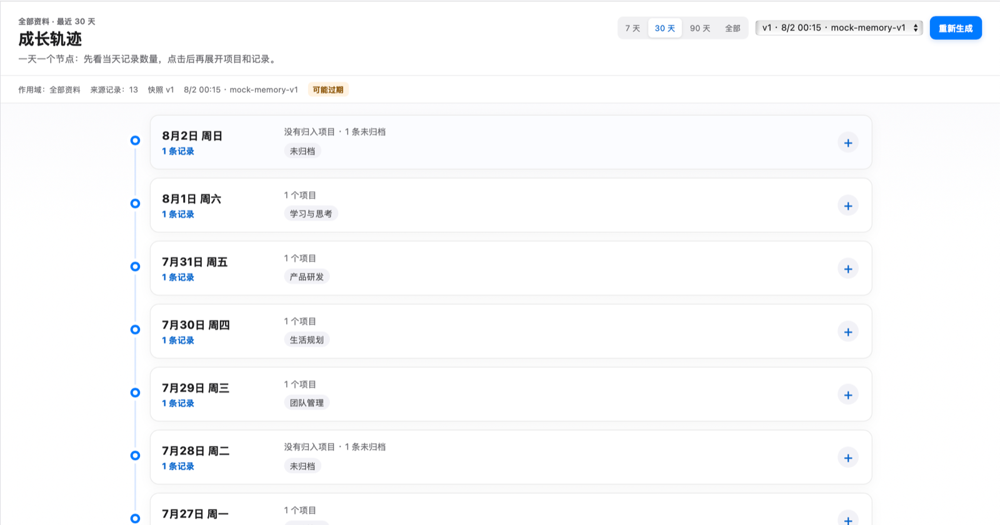
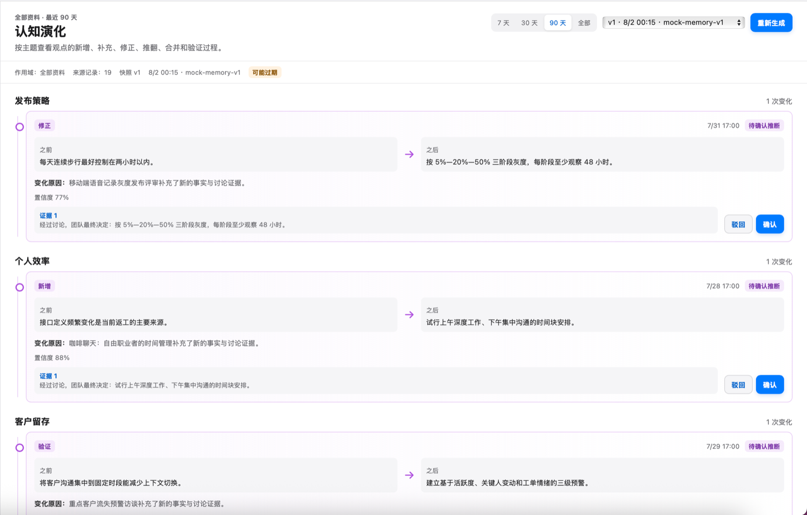

# 回声记忆 / Echo Memory

[](LICENSE)

[English](README.md) · [下载 v1.0.0](https://github.com/questionjie-max/echo-memory/releases/latest) · [MCP 说明](docs/mcp.md) · [安全说明](SECURITY.md) · [参与贡献](CONTRIBUTING.md)

**把你的录音和 AI 对话，变成 Agent 真能复用的记忆。**

你每天在会上拍的板、在 AI 对话里想通的结论，过一周就散在各个 App 里找不到，新开一个 AI 会话又得从头交代背景。

回声记忆把三类来源收进你 Mac 上的一个本地库：

- **录音**——App 内点一下就能本地录音（本机麦克风，停止后自动转写、自动分析），另支持会议、访谈、语音备忘（USB 录音设备自动导入）
- **文档**——Markdown、TXT、DOCX
- **AI 对话**——Claude Code / Codex 本机会话、ChatGPT / Claude 导出记录

转写和分析全在本机跑（Whisper + Ollama，不上云、不限分钟数），每条结论都能点回它出自的原话和时间戳；引用与逐字稿逐字比对，对不上直接丢弃，绝不展示编造的引用。只有你亲自确认过的记忆，才会通过只读 MCP 提供给你的 Agent——它拿到的不是 AI 的猜测，是你认过的账。

**⬇ [下载已签名公证的 macOS 版](https://github.com/questionjie-max/echo-memory/releases/latest)** · macOS Apple Silicon · Apache-2.0

## 它不是什么

不是会议机器人，不是 24 小时录音器，不是团队协作工具。不录系统内放声（线上会议远端声音录不到）、录音时不实时转写（停止后才转写分析）、没有 Windows/手机版、没有云同步——这是取舍，不是欠账。它是采集加沉淀层：App 内点一下就能录，或者材料你带来，它负责让材料以后还能被你和你的 Agent 用上。

## 3 步上手

1. 下载安装包拖入应用文件夹；
2. 点首页「开始记录」录一段，或拖入一段已有录音；
3. 在知识问答里问一个上周的结论，看它能否点回原话。

## 常见问题

- **麦克风权限被拒？** 去「系统设置 → 隐私与安全性 → 麦克风」里放行回声记忆。
- **没装 Ollama，分析用不了？** 点分析会弹出设置面板，本地一键准备或云端填 Key 任选。
- **云端能替代本地吗？** 云端只覆盖分析理解，知识索引仍需本地 Ollama。
- **有 Windows 版吗？** 没有 Windows/手机版、没有云同步、没有自动入会。

## 为什么做它

每个人每天都在产生高价值上下文：会议、电话、客户反馈、个人口述、文档、AI 对话、重要决定和后续结果。这些内容通常散落在不同工具里，很快失去与时间、原始证据和后续变化的联系。

传统工具主要保存文件，或生成一次性的总结。回声记忆围绕一个更长期的闭环设计：

```text
采集 -> 理解 -> 连接 -> 演化 -> 调用 -> 反馈
```

产品目标不是帮助用户保存更多笔记，而是把一个人的经历与判断沉淀为长期、可控、能够服务未来 AI 的个人上下文基础设施。

## 当前已实现

### 核心能力

- **确认过的记忆真能召回了**：问知识库同时检索资料原文与已确认记忆条目，两类来源分开标注（资料原文 / 你的过往记忆）；记忆引用可以跳回原记录或回听原声。
- **AI 对话成为一等输入**：ChatGPT / Claude 导出、对话式 Markdown，以及本机 Agent 会话扫描（Claude Code、Codex），都以独立车道入库——可搜索、可问答，但不混进录音记忆链，也不占用「待处理」队列。
- **个人总述（L3）**：跨快照聚合的第一人称画像（立场、偏好、怎么变过来的、正在关注什么），并通过新的 `get_my_context` 只读 MCP 工具提供给授权 Agent。
- **单条记录的分析补充要求**：在记录的分析面板填「只保留待办事项，按负责人分组」这类要求，优先级高于模板且由代码确定性执行；逐字引用与安全底线始终强制。
- **章节与金句**：长录音自动切成 2–6 个可点击跳播的章节，并给出 0–5 条必须逐字命中的金句（对不上就丢弃）。
- **工作区按录音 / 文档 / AI 对话三类分组**：组头可折叠、显示该类计数与支持的格式，右侧就是这一类的导入入口——入口和内容在同一个地方。
- **存储可见可控**：存储面板分类显示占用，一键清理可再生的中间文件，磁盘紧张时给出提醒；原件永不自动删除。
- **有限自愈**：转写遇到瞬时失败自动重试两次（退避 60/180 秒），应用退出中断的任务下次启动自动重排，`AAC` 音频可正常导入。
- **发布卫生**：发布脚本在公证前审计构建产物（sourcemap、开发残留、开发机路径、开发端点），防的是同类产品打包时栽过的那类残留泄漏。

### 完整工作流

- 首次启动引导：环境体检、本地模型下载（支持断点续传）与收件箱配置；分析模型可稍后在设置里补配，不阻塞开始使用。
- 应用内本地录音：本机麦克风一键录制，停止后自动入库并进入转写与分析队列；异常退出的未封存录音可恢复或放弃。
- 音频收件箱：监听指定文件夹与 USB 录音设备，新音频自动导入、转写、分析。
- 个人词汇库（热词）注入转写，转写后可用本机模型做 AI 校对，原始逐字稿永不覆盖。
- 跨记录行动项与未解决问题仪表盘，可标记完成并跳回原始证据。
- AI 伙伴停靠栏：任意视图顶部随时对话（本地模型默认，可选外部模型），支持总结当前记录、文字创作、启发对话。
- AI 模板向导：对话描述需求，本地模型生成分析模板并入库。
- 产出文件夹：分析、逐字稿、AI 对话成稿统一以标准 Markdown 写入你指定的目录（可指向 Obsidian 等笔记库）。
- 说话人分离：可选启用 whisperX 引擎区分"说话人 1、说话人 2…"，内嵌引擎保持默认、零依赖可用不受影响。
- 说话人重命名：在录音详情把"说话人 1"改成真实姓名，可同时将姓名加入词汇库；行动项与决策自动标注归属人。
- 工作区将记录分为录音 / 文档 / AI 对话三类，组头即可折叠，同时是该类的导入入口。
- 导入 `MP3`、`M4A`、`WAV`、`AAC` 音频，并进行重复文件检测。
- 导入 `Markdown`、`TXT`、`DOCX` 文档，进入同一个可搜索资料库。
- 导入 AI 对话（ChatGPT / Claude 导出）与本机 Agent 会话（Claude Code、Codex），作为独立内容类目：可搜索、可问答，不进入录音记忆链。
- 使用内嵌 Whisper 或本机 `whisper.cpp` 进行本地转写。
- 可选择已配置的 OpenAI-compatible 第三方转写服务。使用前必须完成服务商、地址、模型和 API Key 配置，并单独同意上传原始音频；服务商返回说话人字段时可直接展示，系统不会根据文本猜测。
- 使用本机 Ollama 模型提取摘要、关键观点、决策、待办和未解决问题；单条记录的补充要求可覆盖该次分析的模板结构。
- 可选择已配置的 OpenAI-compatible 第三方文本模型进行结构化分析，但必须单独同意发送转写文本，且不会发送原始音频。
- 为长录音生成可跳播的章节与逐字金句，每一条都经过逐字稿校验。
- 单条记录支持右键转移知识库、重命名、归档/恢复、管理和删除，无需先勾选复选框。
- 保留带时间点的逐字稿证据，并从结论返回原始语料。
- 按项目构建个人知识库，支持本地全文检索和向量检索。
- 对已建立索引的录音、文档与已确认记忆提问，返回可打开的引用并分开标注两类来源。
- 通过按日组织的成长轨迹查看跨项目、跨记录变化。
- 生成带版本、证据和用户反馈的认知演化快照，支持叙事化变更摘要与一键批量确认，并在此之上提供第一人称的个人总述。
- 分类显示资料库占用并可一键清理可再生中间文件；转写任务对瞬时失败自动退避重试，并在中断启动后自动续跑。
- 用户主动开启后，通过本机只读 MCP 向授权的 AI 工具提供上下文。

## 真正的差异

### 时间是记忆的骨架

人生不是文件夹。事件、项目、人物、问题与决策会并行发生，并不断互相影响。回声记忆保留事情发生的时间，以及后来信息与它的关系。

### 原始证据高于 AI 摘要

重要结论应该能回到原始逐字稿、时间点或文档来源。AI 推断会明确标记并允许复核，不会伪装成用户亲自确认的事实。

### 记忆保留演化过程

观点改变不是数据库错误。版本化记忆同时保存过去相信什么、后来改变了什么，以及哪些证据触发了变化。

### 记忆能够被调用

在用户授权后，不同 AI 工具可以通过 MCP 读取完成当前任务所需的个人上下文，用户不必在每个聊天窗口反复介绍自己。

## 当前界面

以下截图使用虚构演示数据。

### 首页录音卡片



### 分析设置面板



### 带证据的知识库问答



### 成长轨迹



### 认知演化



## 本地优先，控制权属于用户

默认情况下，原始音频、SQLite 资料库、本地转写、本地分析、知识检索和 MCP 都保留在 Mac 上运行。

第三方处理默认关闭。第三方转写必须分别完成服务商、地址、模型和 API Key 配置，并单独同意上传原始音频；任一条件缺失时，服务层会在建立上传连接前拒绝执行。第三方文本分析需要另一份文本发送同意，发送内容只有转写文本和结构化分析，不包含原始音频。两道同意门禁都在服务端校验，不能只靠界面控制。API Key 保存在 macOS 钥匙串中。

跨记录生成结果按版本保存，关联原始来源，并允许确认或驳回。它不会覆盖录音、逐字稿或单条记录分析。

## MCP：让多个 Agent 使用同一份个人记忆

当前 MCP Server 使用本机 stdio，默认关闭且只读。它可以搜索记录、读取有限范围的逐字稿、列出项目、获取项目上下文和待办，并读取你确认过的个人总述（`get_my_context`）；不会监听公网端口，也不能修改资料库。

工具清单和开发配置见 [MCP 说明](docs/mcp.md)。

## 产品原则

- **记忆属于用户：** 数据应当可以导出、纠正、删除，并随时撤销授权。
- **原始证据高于 AI 摘要：** 重要结论必须保持可追溯。
- **时间与版本不可丢失：** 新结论不能抹掉过去的判断过程。
- **高影响自动化必须可确认：** 推断出的关系和变化需要允许复核。
- **Agent 遵循最小权限：** 每个任务只获得必要范围的上下文。
- **辅助决策而不是替用户决定：** 不确定性和冲突证据必须保持可见。

## 当前边界与长期方向

当前版本聚焦单用户、单设备的本地工作流。应用内已支持录制本机麦克风，但不录系统内放声（例如线上会议的远端声音），录音过程中也不做实时转写——文字在停止后生成。目前不提供自动入会、手机端、Windows 版、云同步、团队协作、公开 API 或 MCP 写入。

长期方向是从可追溯的谈话记忆，发展为能够沿时间连接事件、人物、项目、问题、知识、决策和结果的个人记忆基础设施。这个方向仍需要持续验证产品价值、隐私边界和用户信任。

## 长期方向

回声记忆不以“转写软件”或“会议总结工具”定义自己。录音、转写和摘要只是输入与处理能力。

长期产品由四个相互连接的层次构成：

1. **Personal Memory Layer（个人记忆层）**：让不同 AI 不必每次从零认识用户，并按授权获得相关上下文。
2. **Cognitive Database（认知数据库）**：保存带证据的知识、决策、问题，以及观点如何发生变化。
3. **Personal Memory OS（个人智能记忆操作系统）**：统一管理记忆的采集、理解、组织、调用和反馈。
4. **Digital Twin Database（数字孪生数据库）**：长期、可纠正地描述一个人经历过什么、知道什么、重视什么，以及如何作出判断。

个人数字孪生是长期产品方向，不代表当前版本已经能够完整建模一个人。


## 仓库目录说明

- `app/`——Tauri 应用本体。`app/src/` 是 React 前端（组件、Hook、共享工具）；`app/src-tauri/src/` 是 Rust 后端（命令、数据库层、原生桥接）；`app/src-tauri/migrations/` 是数据库迁移；`app/tests/ui/` 与 `app/src-tauri/tests/` 分别是前端与后端测试。
- `docs/`——产品文档：`docs/mcp.md`（MCP 说明）、`docs/macos-signing.md`（签名与公证）、`docs/analysis-quality.md`、`docs/plans/`（设计与规划笔记）、`docs/release-notes-*.md`（各版本发布说明，含 v1.0.0）、`docs/images/`（说明文档引用的截图）。
- `benchmarks/`——性能基准与示例片段。
- `.github/`——CI 工作流（`workflows/ci.yml`）与 Bug 反馈模板。
- 根目录文件——`README.md` / `README.zh-CN.md`（本介绍）、`LICENSE`（Apache-2.0）、`CONTRIBUTING.md`、`SECURITY.md`、`CITATION.cff`。

## 环境要求

- Apple Silicon Mac
- Node.js 22+、Rust stable、Cargo 和 Xcode Command Line Tools
- 首次构建内嵌 Whisper 时需要 CMake
- 本机可读的 Whisper `ggml-*.bin` 模型
- 可选：本机 `whisper-cli` / `WHISPER_CPP_BIN`
- 可选：本机 Ollama 服务和模型，用于分析
- 可选：`pip install whisperx` 与 HuggingFace Token（接受 pyannote 模型协议），用于说话人分离

## 本地运行

```bash
cd app
npm install
bash scripts/check-env.sh
npm run tauri dev
```

默认资料库位置为 `~/Library/Application Support/回声记忆`。开发或测试时可以设置 `ECHO_LIBRARY_ROOT` 使用独立资料库。

## 验证命令

```bash
cd app
npm run typecheck
npm run build
npm run test:growth
npm run test:ui
cd src-tauri
cargo fmt --check
cargo test --features mcp-bin
```

## 项目状态

回声记忆当前版本为 v1.0.0，可从 [GitHub Releases](https://github.com/questionjie-max/echo-memory/releases) 下载最新公开版，也支持从源码构建。发布物只有在真实通过签名、公证和装订验证后，才会标注为 Apple 已签名和已公证；否则必须明确标注实际状态。

完整 v1.0.0 说明（重点、验证状态、分发 SHA-256 与公证）：[docs/release-notes-v1.0.0.md](docs/release-notes-v1.0.0.md) 与 [v1.0.0 发布页](https://github.com/questionjie-max/echo-memory/releases/tag/v1.0.0)。

欢迎参与贡献。提交 Issue 或 PR 前请阅读 [CONTRIBUTING.md](CONTRIBUTING.md)，不要在公开 Issue 中附带真实音频、逐字稿、数据库、密钥或客户资料。安全问题请按 [SECURITY.md](SECURITY.md) 私密报告。

## 许可证

Apache-2.0，见 [LICENSE](LICENSE)。
